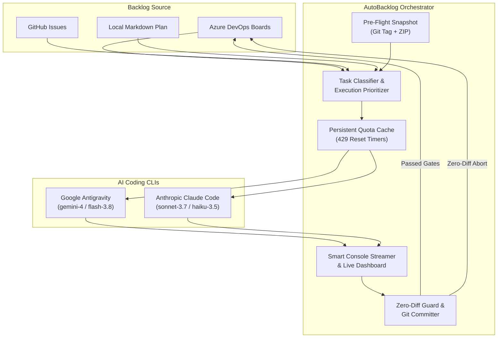

# 🚀 AutoBacklog

[](LICENSE)
[](https://www.python.org/)
[]()

**AutoBacklog** is an autonomous, resilient backlog runner powered by AI coding CLIs (**Google Antigravity** and **Anthropic Claude Code**). It connects directly to your issue tracking system (Azure DevOps Boards, GitHub Issues, or local Markdown plans), prioritizes open tasks, routes them to optimal model tiers, and executes them continuously through verifiable quality gates.

---

## ✨ Key Capabilities

* 🎯 **Universal Backlog Adapters:**
  * **Azure DevOps Boards**: Full WIQL queries, real-time status transitions (`New` -> `Active` -> `Resolved`), and `--discussion` progress logging.
  * **GitHub Issues**: Automatic git remote detection, labels filtering, and interactive discussion comments.
  * **Local Markdown Plans**: Zero-cloud offline mode parsing `#123 Title` or `- [ ] [TASK-1] Title` from `PLAN.md` or `BACKLOG.md`.

* 🧠 **Multi-Provider & Dynamic Model Routing:**
  * **Google Antigravity (`agy.exe`)**: Tiering between Large (`gemini-4-argon-high` / `claude-opus-5-5-high`) and Small (`gemini-3.8-flash-high` / `claude-sonnet-5-5-high`).
  * **Anthropic Claude Code (`claude`)**: Tiering between Sonnet 3.7 and Haiku 3.5 for users with a Claude subscription.
  * **Independent Quota Resilience**: When a model hits its rate-limit (HTTP 429), AutoBacklog records the reset countdown and keeps processing the other task tiers without terminating the run.

* 🛡️ **Autonomous Safety Net:**
  * **Pre-flight Snapshots**: Automatically creates a timestamped git checkpoint tag and ZIP archive before running. Restore anytime via `autobacklog restore`.
  * **Zero-Diff Revert Guard**: If an AI run aborts or encounters an error without touching files, the ticket is safely reverted back to `New` with an explanatory note.
  * **Hardware Integration**: Automatically detects connected physical test devices over ADB (e.g., Samsung / Pixel) and injects device specifications into the AI prompt for hardware verification.

* 📊 **Observability & Live Reporting:**
  * **Smart Console Streamer**: Clean terminal output with automatic deduplication of noisy polling loops.
  * **Live Progress Dashboard**: Generates and updates `RUN_SUMMARY.md` in real-time.

---

## 🏗️ Architecture



---

## ⚡ Quickstart

### 1. Installation

Clone and install AutoBacklog in your environment:

```bash
git clone https://github.com/allardv03/AutoBacklog.git
cd AutoBacklog
pip install -e .
```

### 2. Launch the Web UI (For "CLI Noobs" & Visual Users) 🌐

Don't want to fiddle with command lines or YAML files? Simply start the built-in local web dashboard:

```bash
autobacklog ui
# or: autobacklog web
```

This immediately opens `http://localhost:8080` in your browser where you can:
* Configure your Azure DevOps, GitHub, or Markdown backlog visually.
* See open tasks, priorities, and AI model tiering.
* Click **"▶️ Start Runner"** or run specific tasks with 1 tap.
* Watch the live console stream in real-time.

---

### 3. Initialize via CLI (Alternative)

Navigate to your target project folder and run:

```bash
# For Azure DevOps Boards:
autobacklog init --type azure

# For GitHub Issues:
autobacklog init --type github

# For local Markdown:
autobacklog init --type markdown
```

This creates an `autobacklog.yaml` configuration file in your project root.

### 3. Dry-Run

Inspect open items and dynamic model assignments without executing any AI prompts:

```bash
autobacklog dry-run
```

### 4. Start the Autonomous Runner

```bash
# Run automatically with your configured settings
autobacklog run

# Run using a specific provider
autobacklog run --provider claude

# Target a single ticket ID
autobacklog run --id 186
```

---

## 🛠️ CLI Reference

| Command | Description |
|---|---|
| `autobacklog ui` / `web` | Launches the local Web UI dashboard in your browser. |
| `autobacklog run` | Starts the continuous execution loop via terminal. |
| `autobacklog run --id <N>` | Runs a specific work item ID and exits. |
| `autobacklog run --provider <auto\|agy\|claude>` | Overrides the active AI CLI provider. |
| `autobacklog dry-run` | Previews open tasks and quota status without running AI. |
| `autobacklog summary` | Displays the current session dashboard from `RUN_SUMMARY.md`. |
| `autobacklog restore` | Restores files from the most recent pre-flight snapshot archive. |
| `autobacklog clear-quota` | Resets cached 429 rate-limit locks. |
| `autobacklog init` | Generates a starter `autobacklog.yaml`. |

---

## ⚙️ Configuration File (`autobacklog.yaml`)

```yaml
project_name: "MyProject"
system_prompt_intro: "You are an autonomous Senior Software Engineer."
max_rounds: 1000
cooldown_seconds: 10

backlog:
  type: "azure_boards" # 'azure_boards', 'github_issues', or 'markdown'
  org_url: "https://dev.azure.com/your-org"
  project: "YourProject"
  execution_order: [184, 217, 219, 178]
  non_executable_ids: [127, 141]
  include_ideas: false

provider:
  type: "auto" # 'auto', 'agy', or 'claude'
  large_model: "gemini-4-argon-high"
  large_fallback: "claude-opus-5-5-high"
  small_model: "gemini-3.8-flash-high"
  small_fallback: "claude-sonnet-5-5-high"

safeguards:
  create_snapshots: true
  snapshots_dir: "_snapshots"
  auto_revert_zero_diff: true
  quota_cache_file: "_snapshots/model_quota_cache.json"

reporters:
  dashboard_file: "RUN_SUMMARY.md"
  stream_console: true

hardware:
  detect_adb: true
```

---

## 🧪 Testing

Run the test suite:

```bash
python -m unittest discover
```

---

## 📄 License

MIT License. See [LICENSE](LICENSE) for details.
